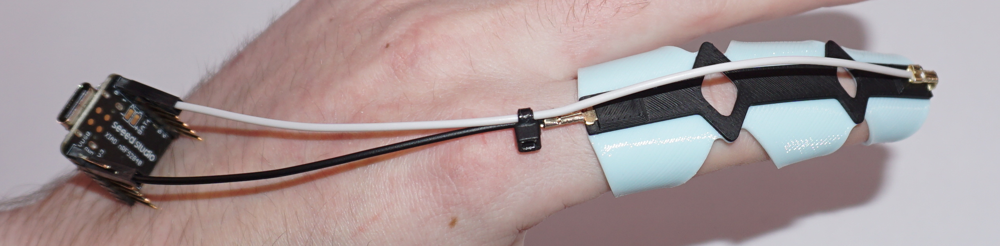

# 🧤 OpenPrintSense - 3D Printed BLE Flex Sensor Glove



An open-source 3D-printed smart glove that measures finger flexion using stretch sensors and transmits data via Bluetooth Low Energy (BLE) to an Android app in real-time.


## 📖 Overview

OpenPrintSense is an open-source project that combines 3D printing, hardware, and software to create a wearable finger tracking system. The key innovation is a **fully 3D-printed flex sensor** that uses conductive TPU filament - as the sensor bends, its electrical resistance changes, allowing precise measurement of finger flexion. Data is transmitted wirelessly via BLE to an Android smartphone.

### How It Works

The 3D-printed sensor combines flexible TPU with conductive filament. When you bend your finger:
1. The conductive filament stretches
2. This increases the electrical resistance
3. The microcontroller reads the resistance change via analog input
4. The bend angle is calculated and sent to the app

### Use Cases
- 🎮 Gesture-based game controllers
- 🤖 Robot hand control
- 🏥 Rehabilitation therapy tracking
- 🎵 Musical instrument interfaces
- 📊 Motion capture for research

## 🔧 Hardware Requirements

### Electronics
- **Microcontroller**: [Seeed XIAO nRF52840 Sense](https://www.seeedstudio.com/Seeed-XIAO-BLE-Sense-nRF52840-p-5253.html)
- **Power**: USB-C or 3.7V LiPo battery
- **Wires**: For connecting sensor to microcontroller

### 3D Printing Materials
- **Flexible Base**: [Bambu Lab TPU 90A](https://eu.store.bambulab.com/de/products/tpu-85a-tpu-90a) - Flexible structure
- **Conductive Element**: [Recreus FilaFlex Conductive](https://recreus.com/en/products/filaflex-conductivo) - Variable resistance sensing

### CAD Files
The 3D model is available in `/CAD Files/OpenPrintSense.step` - compatible with all major CAD software and slicers.

### Wiring Diagram

```
3D Printed Sensor ──┬── A0 (Analog Input)
                    │
                    └── GND (with pull-down resistor)
```

### Printing Tips
- Print the TPU base at 230°C, bed 35°C
- Print conductive filament at 250°C with 105% Flow
- Use multi-material printing or manual filament swap
- Ensure good layer adhesion for reliable conductivity

## 📱 Software Components

### Arduino Firmware (`/nRF52840`)
- BLE service with multiple characteristics (Adafruit Bluefruit / Nordic SoftDevice)
- Encrypted connection with PIN pairing
- Real-time sensor reading and transmission
- Manual calibration support via BLE
- Unique device ID for multi-glove setups

### Android App (`/AndroidApp`)
- Material Design UI with dark theme
- Real-time flex percentage display
- Manual calibration workflow
- Multi-language support (English/German)
- Device ID display

## 🚀 Getting Started

### 1. Flash the Arduino Firmware

1. Install [Arduino IDE](https://www.arduino.cc/en/software)
2. Add Seeed nRF52 board support:
   - Go to `File → Preferences`
   - Add to "Additional Board URLs":
     ```
     https://files.seeedstudio.com/arduino/package_seeeduino_boards_index.json
     ```
3. Install **"Seeed nRF52 Boards"** from Board Manager (not "Seeed nRF52 mbed-enabled Boards")
4. Select `Seeed XIAO nRF52840 Sense` as your board (not the "(No Updates)" variant)
5. Create `/nRF52840/secrets.h` with your own pairing PIN (see [Customization](#️-customization)), then open `/nRF52840/nRF52840.ino`
6. Upload

### 2. Build the Android App

1. Open `/AndroidApp` in [Android Studio](https://developer.android.com/studio)
2. Wait for Gradle sync to complete
3. Build and install on your Android device (API 26+)

### 3. Pairing

The glove only talks to paired phones over an encrypted connection. Pairing requires the PIN set in the firmware.

1. Power on the glove
2. Press "Connect" in the app
3. Enter the glove's PIN in the pairing dialog
4. From then on the app reconnects automatically and only trusts this glove

To remove all pairings, send `CLEAR` over the serial monitor (115200 baud) and remove the glove in Android's Bluetooth settings.

### 4. Calibration

1. Put on the glove
2. Connect via the app
3. Press "Start Calibration"
4. Fully bend your finger → Press "Set Min"
5. Fully extend your finger → Press "Set Max"
6. Done! The app now shows accurate flex percentage

## 📡 BLE Protocol

| UUID | Name | Properties | Description |
|------|------|------------|-------------|
| `19B10001-...` | Stretch | Read, Notify | Flex percentage (0-100%) |
| `19B10002-...` | Raw | Read, Notify | Raw sensor value (0-1023) |
| `19B10003-...` | Device ID | Read | Unique device identifier |
| `19B10004-...` | Min Cal | Read, Write | Calibration min value |
| `19B10005-...` | Max Cal | Read, Write | Calibration max value |
| `19B10006-...` | Calibrated | Read, Notify | Calibration status |

All characteristics require an encrypted (paired) connection. Calibration values outside 0–1023 are rejected.

## 📁 Project Structure

```
OpenPrintSense/
├── CAD Files/
│   └── OpenPrintSense.step   # 3D model for printing
├── nRF52840/
│   └── nRF52840.ino          # Arduino firmware
├── AndroidApp/
│   ├── app/
│   │   └── src/main/
│   │       ├── java/         # Kotlin source code
│   │       └── res/          # Layouts, drawables, themes
│   ├── build.gradle.kts
│   └── settings.gradle.kts
├── LICENSE
└── README.md
```

## 🛠️ Customization

### Change Device ID and PIN
Edit the device ID in `nRF52840.ino`:
```cpp
const char* DEVICE_ID = "SG-002";  // Change for each glove
```

Set your own pairing PIN in a new file `nRF52840/secrets.h`. It is ignored by git, so your PIN never ends up in the repository:
```cpp
#define PAIRING_PIN "654321"  // 6 digits; anyone who knows the PIN can pair
```
Without this file the firmware falls back to `123456` and prints a compiler warning.

### Add More Sensors
The firmware can be extended to support multiple flex sensors for full hand tracking.

## 🐛 Troubleshooting

| Problem | Solution |
|---------|----------|
| Upload fails | Double-tap RESET button to enter bootloader mode |
| App can't find device | Enable Bluetooth (and Location on Android 11 or older) |
| Pairing failed | Check the PIN and connect again |
| Connection drops after ~20 s | The pairing is missing on the glove or phone: remove the glove in Android's Bluetooth settings and pair again |
| Serial monitor shows nothing | Enable DTR in your serial terminal (the Arduino IDE does this automatically) |
| App ignores a new glove | The app only trusts gloves it has paired with. Remove the old glove in Android's Bluetooth settings |
| Raw value always 0 | Check sensor wiring to A0 pin |
| Calibration not working | Ensure you're connected before calibrating |

## 📄 License

This project is licensed under the MIT License - see the [LICENSE](LICENSE) file for details.

## 🤝 Contributing

Contributions are welcome! Please feel free to submit a Pull Request.

1. Fork the repository
2. Create your feature branch (`git checkout -b feature/AmazingFeature`)
3. Commit your changes (`git commit -m 'Add some AmazingFeature'`)
4. Push to the branch (`git push origin feature/AmazingFeature`)
5. Open a Pull Request

## 📬 Contact

E-Mail: [mailto:kontakt@paulbuda.de](mailto:kontakt@paulbuda.de)

---

⭐ If you find this project useful, please give it a star!
